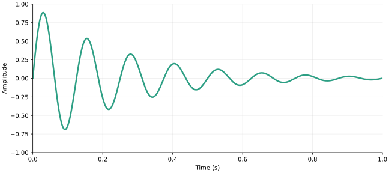
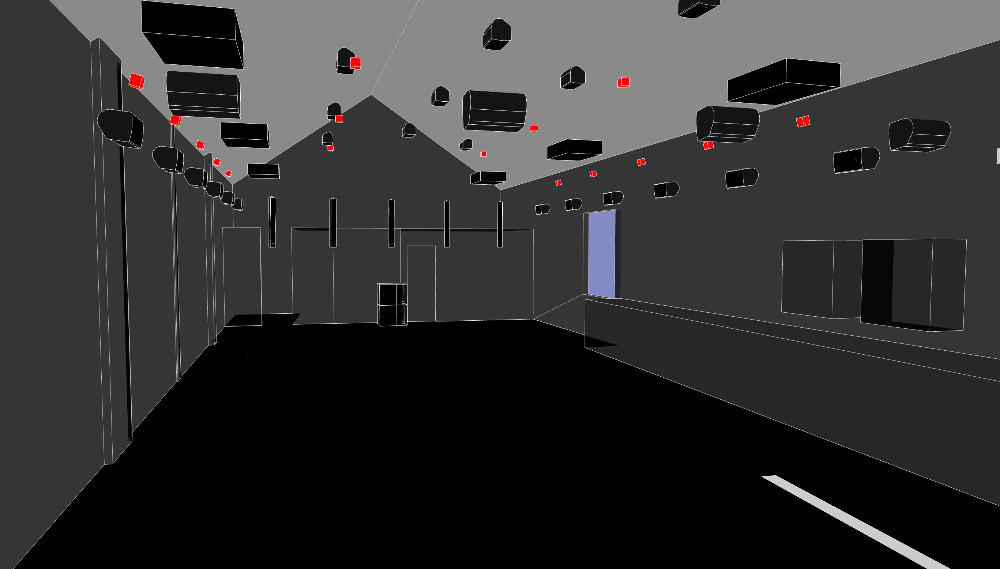

## Section title {.divider background-image="assets/divider2.jpg" background-size="cover" background-color="#083959" background-opacity="0.5"}

A short introduction to the next part

::: {.notes}
Replace assets/divider.jpg with your own landscape image. This example is the room rendering from the Artificial Audio website, content/portfolio/RES/featured.jpg. The dark background and image opacity keep the heading readable.
:::

## Single column

- The main idea belongs in the first bullet
- A second point adds the supporting detail
  - One short subpoint when it helps
- **Emphasis** highlights the key phrase
- A final point closes the thought

## Two columns

:::: {.columns}
::: {.column width="47%"}
### First topic

- One clear point per bullet
- Supporting detail stays brief
- A final observation
:::

::: {.column width="47%"}
### Second topic

- A parallel idea or comparison
- **Emphasis** for the key phrase
- A final observation
:::
::::

## AA color scheme

Seven colors sampled from the logo, shared by the theme and figures.

<div class="aa-palette-demo">
<div><span style="background: var(--aa-navy)"></span><strong>Navy</strong><br><code>#083959</code></div>
<div><span style="background: var(--aa-cream)"></span><strong>Cream</strong><br><code>#FCF5ED</code></div>
<div><span style="background: var(--aa-teal)"></span><strong>Teal</strong><br><code>#2D9F84</code></div>
<div><span style="background: var(--aa-orange)"></span><strong>Orange</strong><br><code>#F57F33</code></div>
<div><span style="background: var(--aa-coral)"></span><strong>Coral</strong><br><code>#DF514D</code></div>
<div><span style="background: var(--aa-blue)"></span><strong>Blue</strong><br><code>#22669F</code></div>
<div><span style="background: var(--aa-purple)"></span><strong>Purple</strong><br><code>#655485</code></div>
</div>

:::: {.columns}
::: {.column width="47%"}
### Color roles

Navy text on cream. Teal and the warm accents highlight graphics and chart series.

Use the darker `aa-link` and `aa-muted` variants for small text.
:::
::: {.column width="47%"}
### Reuse a color

```css
color: var(--aa-link);
background: var(--aa-cream);
```

Edit `theme/aa-palette.scss` to update the palette across the deck.
:::
::::

## Math

Inline math uses single dollar signs: $f_s = 48\,000\,\mathrm{Hz}$.

Display equations use double dollar signs:

$$
x(t) = e^{-\alpha t}\sin(2\pi f_0 t)
$$ {#eq-decay}

```latex
$x(t)$

$$
x(t) = e^{-\alpha t}\sin(2\pi f_0 t)
$$ {#eq-decay}
```

Refer to a labeled equation with `@eq-decay`: see @eq-decay.

## Python code listing

Use a fenced `.python` block for highlighted code without execution.

```{.python code-line-numbers="|4|5-6"}
from math import pi, sin

sample_rate = 48_000
frequency = 440
samples = [sin(2 * pi * frequency * n / sample_rate)
           for n in range(sample_rate)]
```

Add `code-line-numbers="|4|5-6"` to step through highlighted lines.

::: {.notes}
Advance twice to highlight the frequency and then the sample generation. A plain python listing is displayed only; a {python} cell executes during rendering.
:::

## Making a figure with Python

:::: {.columns}
::: {.column width="47%"}
```python
import math
import matplotlib.pyplot as plt

t = [i / 1000 for i in range(1001)]
y = [math.exp(-4 * x)
     * math.sin(2 * math.pi * 8 * x)
     for x in t]
fig, ax = plt.subplots()
ax.plot(t, y)
ax.set(xlabel="Time (s)",
       ylabel="Amplitude")
fig.savefig("assets/damped-sine.svg")
```
:::
::: {.column width="47%"}
{#fig-decay width="100%" fig-alt="Eight oscillations over one second with an exponentially decreasing amplitude."}

Save as SVG for a sharp figure at any zoom level. See @fig-decay.
:::
::::

::: {.notes}
The full runnable example is demos/make_assets.py. Run it from any directory to regenerate the checked-in figure and audio. Matplotlib is only needed when regenerating the assets.
:::

## Running Python during rendering

Use `{python}` to execute a cell and insert its output automatically.

````markdown
```{python}
#| label: fig-python
#| fig-cap: "A simple Python plot."
#| fig-alt: "A line rising from zero to one and falling to zero."
#| echo: false
import matplotlib.pyplot as plt
plt.plot([0, 1, 2], [0, 1, 0])
plt.show()
```
````

Install `jupyter` and `matplotlib`, then remove `engine: markdown` from
the YAML to enable execution. This deck uses saved assets by default.

## YouTube video



Use the `video` shortcode with a YouTube URL or a local `.mp4` path.

[Open the example on YouTube](https://www.youtube.com/watch?v=wo9vZccmqwc) · Internet required for YouTube playback

::: {.notes}
Source and syntax: https://quarto.org/docs/authoring/videos.html. Replace the URL with your own video. YouTube may restrict embedded playback; use the direct link if needed. Videos do not play in PDF exports.
:::

## Including audio

A two-second, 440 Hz sine tone with a short fade at each end.

<audio controls preload="metadata" aria-label="Play a two-second 440 hertz sine tone" src="assets/tone.wav">
Your browser does not support audio playback.
</audio>

```html
<audio controls preload="metadata"
       aria-label="Play a two-second 440 hertz sine tone"
       src="assets/tone.wav">
</audio>
```

Click play to start. Local audio is embedded in the HTML export.
For speech, include a transcript; for PDF, provide a separate audio link.

## Images and captions

:::: {.columns}
::: {.column width="47%"}
{width="100%" fig-alt="Interior rendering of an audio research room."}
:::
::: {.column width="47%"}
```markdown
{
  width="100%"
  fig-alt="Interior rendering of an audio research room."
}
```

Use a caption to explain the image and `fig-alt` to describe its content.
:::
::::

::: {.notes}
Image source: artificial-audio/artificial-audio.github.io, content/portfolio/RES/featured.jpg (the same asset as the divider).
:::

## Tables

| Format | Typical use | Plays in PDF? |
|:-------|:------------|:-------------:|
| SVG / PNG | Figures and images | Static |
| WAV / MP3 | Audio examples | No |
| MP4 / YouTube | Video examples | No |

: Media choices for a presentation. {#tbl-media}

```markdown
| Format | Typical use |
|:-------|:------------|
| SVG    | Figures     |
| WAV    | Audio       |
```

## Incremental reveals

Wrap a list in `::: {.incremental}` to reveal one point at a time.

::: {.incremental}
- Introduce the input signal
- Explain the processing step
- Reveal the output and compare
:::

::: {.notes}
These are speaker notes, visible in the speaker view opened with S. Pause after each reveal and ask the audience what they expect next.
:::

## Links and speaker notes

:::: {.columns}
::: {.column width="47%"}
### Navigation

[Return to the math example](#math)

[Quarto slide documentation](https://quarto.org/docs/presentations/revealjs/)

Use **Esc** for the overview and **S** for speaker view.
:::
::: {.column width="47%"}
### Private prompts

```markdown
::: {.notes}
Pause for questions.
Remind the audience of the units.
:::
```

Notes are hidden during the talk but remain in the shared HTML source.
:::
::::
